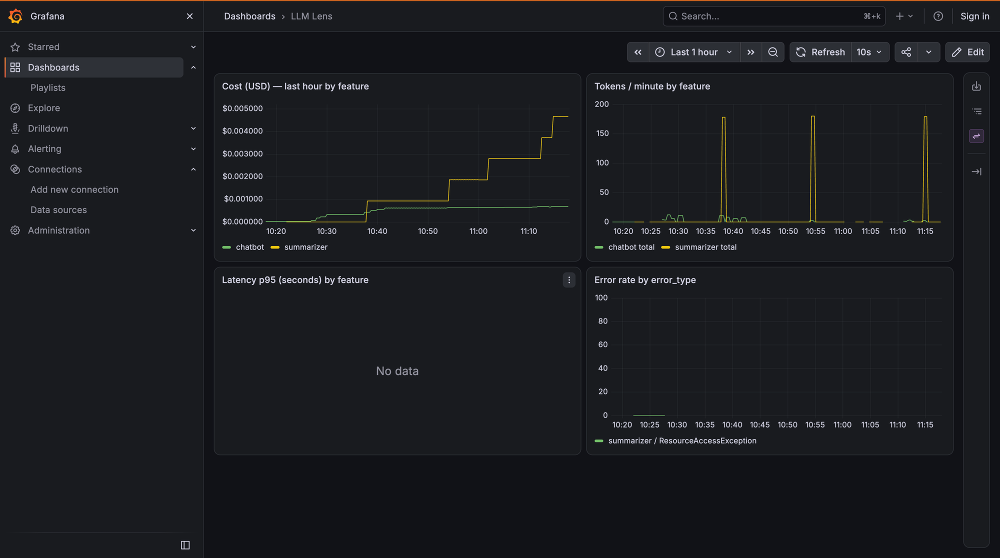
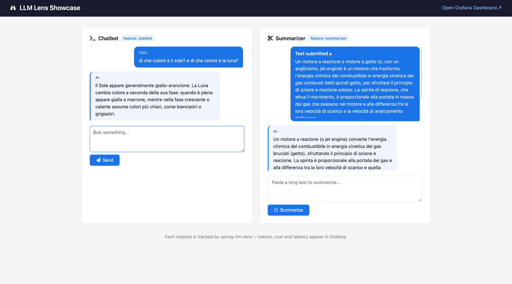

# spring-llm-lens

A Spring Boot starter that automatically tracks **tokens, cost, latency, and errors** for every LLM call made through Spring AI — per feature, per model, zero boilerplate.

## What it does

Add one dependency and every `ChatClient` call in your application gets:

| Signal | How |
|---|---|
| Input/output token counts | Micrometer counters (`llm.tokens.input`, `llm.tokens.output`) |
| Estimated USD cost | Micrometer counter (`llm.cost.usd`) based on built-in price table |
| Request latency | Micrometer timer (`llm.request.duration`) with p50/p95/p99 |
| Error tracking | Micrometer counter (`llm.request.errors`) tagged by exception type |
| Distributed traces | OpenTelemetry spans exported to any OTLP-compatible backend |

All metrics are tagged with `model` (e.g. `gpt-4o-mini`) and `feature` (e.g. `chatbot`, `summarizer`), so you can slice cost and latency per business feature.

<p align="center">
  
</p>

## Architecture

```
Your Spring Boot App
  │
  ├── @LlmFeature("chatbot")       ← AOP aspect sets feature name in ThreadLocal
  │       │
  │       └── ChatClient.call()
  │               │
  │               └── LlmObservabilityAdvisor  ← Spring AI CallAdvisor
  │                       │
  │                       ├── records tokens + latency → LlmMetricsRecorder
  │                       ├── calculates cost         → LlmCostCalculator
  │                       └── exports span            → OpenTelemetry
  │
  └── /actuator/prometheus  ← Micrometer Prometheus endpoint
```

**Modules:**
- `spring-llm-lens-starter` — the autoconfigured library (add this to your app)
- `llm-lens-showcase` — demo Spring Boot app with chatbot + summarizer UIs

## Quick start

### 1. Add the dependency

```xml
<dependency>
    <groupId>io.github.forpiller</groupId>
    <artifactId>spring-llm-lens-starter</artifactId>
    <version>0.1.0-SNAPSHOT</version>
</dependency>
```

You also need Micrometer Prometheus registry and Spring Boot Actuator:

```xml
<dependency>
    <groupId>io.micrometer</groupId>
    <artifactId>micrometer-registry-prometheus</artifactId>
</dependency>
<dependency>
    <groupId>org.springframework.boot</groupId>
    <artifactId>spring-boot-starter-actuator</artifactId>
</dependency>
```

### 2. Expose the Prometheus endpoint

```yaml
# application.yml
management:
  endpoints:
    web:
      exposure:
        include: health,prometheus
```

### 3. Annotate your methods

```java
@Service
public class MyService {

    private final ChatClient chatClient;

    @LlmFeature("my-feature")
    public String ask(String question) {
        return chatClient.prompt()
            .user(question)
            .call()
            .content();
    }
}
```

That's it — no other configuration needed.

## Configuration reference

```yaml
llm:
  lens:
    default-feature: unknown        # feature name when @LlmFeature is absent
    pricing:
      models:
        my-custom-model:
          input-per-million-tokens: 2.00
          output-per-million-tokens: 8.00
```

### Built-in price table

| Model | Input ($/M tokens) | Output ($/M tokens) |
|---|---|---|
| `gpt-4o` | 5.00 | 15.00 |
| `gpt-4o-mini` | 0.15 | 0.60 |
| `claude-3-5-sonnet` | 3.00 | 15.00 |
| `claude-3-5-haiku` | 0.80 | 4.00 |

Override any entry or add new models via `llm.lens.pricing.models`.

## Programmatic feature context

For cases where `@LlmFeature` isn't enough (e.g. inside a lambda or a non-Spring object):

```java
String result = LlmFeatureContext.with("batch-processor", () ->
    chatClient.prompt().user(text).call().content()
);
```

## Metrics reference

| Metric | Type | Tags |
|---|---|---|
| `llm.tokens.input` | Counter | `model`, `feature` |
| `llm.tokens.output` | Counter | `model`, `feature` |
| `llm.cost.usd` | Counter | `model`, `feature` |
| `llm.request.duration` | Timer | `model`, `feature`, `status` (`success`/`error`) |
| `llm.request.errors` | Counter | `model`, `feature`, `error_type` |

## Showcase app

The included `llm-lens-showcase` module is a demo Spring Boot app with a chatbot and a text summarizer, each tagged with a different `@LlmFeature` label. Every interaction is automatically observed — tokens, cost, and latency surface in Grafana in real time.

<p align="center">
  
</p>

## Running the observability stack

A ready-to-use Docker Compose stack (Prometheus + Tempo + Grafana) lives in `observability/`.

```bash
# Build the showcase jar first
cd llm-lens-showcase
mvn clean package -DskipTests

# Start the full stack (set your OpenAI key)
cd ../observability
ANTHROPIC_API_KEY=sk-ant-... docker compose up
```

Services:
| Service | URL |
|---|---|
| Showcase app | http://localhost:8080 |
| Grafana dashboards | http://localhost:3000 |
| Prometheus | http://localhost:9090 |
| Tempo | http://localhost:3200 |

The **LLM Lens** dashboard is pre-provisioned in Grafana — no manual setup needed.

## Running tests

```bash
# From project root — runs the starter's full test suite (18 tests)
mvn test -pl spring-llm-lens-starter
```

## Running the showcase locally (without Docker)

```bash
export ANTHROPIC_API_KEY=sk-ant-...
cd llm-lens-showcase
mvn spring-boot:run
```

Open http://localhost:8080 — you'll find a chatbot and a text summarizer, each tagged with a different `@LlmFeature` label.

## Known limitations

**ThreadLocal and reactive/virtual threads.** `LlmFeatureContext` uses a plain `ThreadLocal`, which is not propagated to virtual-thread children (structured concurrency) or to reactive pipelines (WebFlux). When using these stacks, set the feature manually via `LlmFeatureContext.with()` inside the reactor chain or task scope. A future release may support `Reactor Context` and `ScopedValue`.

**Spring AOP proxy bypass.** `@LlmFeature` is intercepted by Spring AOP, which is proxy-based. A direct `this.myMethod()` call inside the same bean will skip the proxy and the feature name will not be set. Call the annotated method through another Spring bean, or use `LlmFeatureContext.with()` as the programmatic alternative.

## Requirements

- Java 21+
- Spring Boot 3.3.x
- Spring AI 1.0.0
